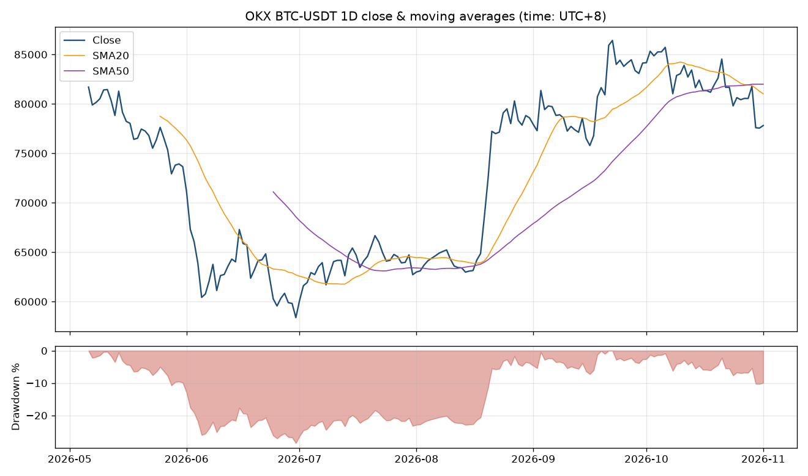

# 03 OKX 公开行情 K 线命令行工具

## 解决什么问题
常见需求:“定期从某个 API 拉数据,算几个指标,出一张表和一张图。”
本工具调用 OKX **公开、免登录**的行情接口(`/api/v5/market/history-candles`),一条命令输出:

- 每个交易对的 K 线明细 CSV(含收益率、SMA20/SMA50、回撤)
- 多个交易对的汇总对比 CSV(区间涨跌、年化波动率、最大回撤、上涨 K 线占比等)
- 每个交易对一张 PNG 图(收盘价 + 均线 + 回撤)

**只读数据,不需要 API Key,不涉及任何下单或账户操作。**

## 工程要点
- 自动分页(单次最多 100 条,用 `after` 参数向前翻页),可拉取任意根数
- 处理接口错误码、HTTP 429 限频退避重试、请求间隔
- 时间统一转为北京时间(UTC+8),按时间排序、去重
- `--base-url` 可替换接口域名;`--offline` 可读本地 JSON,网络不通时也能演示
- 用 mock 测试分页逻辑和错误处理,测试不依赖网络

## 使用方法
```bash
pip install -r requirements.txt
python okx_candles.py BTC-USDT ETH-USDT XAUT-USDT --bar 1D --limit 180
python okx_candles.py BTC-USDT-SWAP --bar 4H --limit 300 --out output/swap
python make_sample_data.py && python okx_candles.py BTC-USDT --offline sample_data/btc_usdt_1d_sample.json --out output/offline_demo
python -m pytest -q   # 运行测试(6 个)
```
参数:`--bar` 周期(1H / 4H / 1D / 1W 等),`--limit` 根数,`--out` 输出目录。

> 注意:国内网络访问 okx.com 可能不稳定,可用 `--offline` 模式演示;最后一根 K 线可能尚未收盘(CSV 中 `confirm=0`)。`sample_data/` 里是随机生成的模拟行情,不是真实数据。

## 示例输出(真实运行结果,2026-11-01,最近 180 根日线)
```
instId                      BTC-USDT          ETH-USDT         XAUT-USDT
period_return_pct              -4.76             -3.87            -17.15
annualized_vol_pct             38.83             51.43             21.99
max_drawdown_pct              -28.54            -33.85            -17.95
up_bars_pct                     54.7              51.4              45.8
last_vs_sma20_pct              -3.96             -4.59             -4.45
```
输出文件:`output/summary_1d.csv`、`output/*_candles.csv`、`output/*_chart.png`



## 技术栈
Python 3.10+、requests、pandas、matplotlib、argparse、pytest(unittest.mock)

## 免责声明
仅为数据处理演示,指标是历史统计,不构成任何投资建议。
